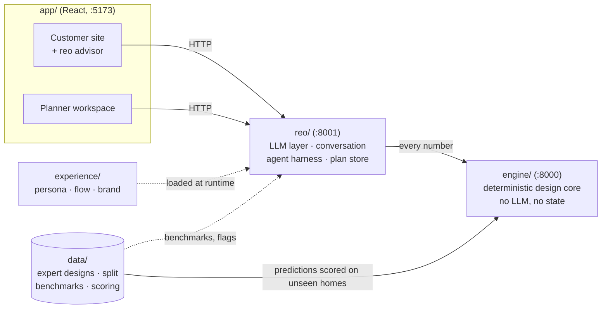

# reo — an AI companion that designs home energy systems like an expert installer

**Give reo one number from your electricity bill and it answers in seconds: a complete system (solar, battery, heat pump, wallbox), a price range, and a reason for every number. The installer's planner then receives a ready offer, not a lead, and can change anything while the rest of the design re-derives.**

*Built for the Reonic Hackathon (Munich, 7–8 Nov 2026) — challenge "AI-designed home energy systems".*

---

## Try it live

| | |
|---|---|
| **Live app** | **https://sonnfeld-reo.vercel.app** |
| **Access code (demo gate)** | **`1234`** — asked once when the site opens |
| **Planner workspace** | https://sonnfeld-reo.vercel.app/#/installer |
| **Planner access code** | **`1234`** — asked when the planner workspace opens |

**Three-minute tour**

1. Open the live app, enter `1234`, click **Plan my home**.
2. Type a yearly use of **4500** kWh, the address **Türkenstr. 58, 80799 München** (or the offline demo address *Musterstraße 12, 80331 München*), say you plan an **electric car** and heat with **gas**. You get a design, a price range marked *estimate*, savings, payback, and a gas-vs-heat-pump comparison with CO₂. Toggle the heat pump off and on; the design re-derives.
3. Hand the plan over, then open the **planner workspace** (`/#/installer`, code `1234`). The new plan is on top: see the modules already placed on the roof photo, drag one, watch price and savings change, tap *Ask reo why*, and approve the proposed actions.
4. Finalise and send the quote: the customer's page now shows the confirmed plan.

> The live backend runs on a team laptop behind a tunnel. If the page reports that it cannot calculate, see [Run it yourself](#run-it-yourself) (three commands, no API key needed) or watch the recorded demo. Details: [app/DEPLOYMENT.md](app/DEPLOYMENT.md).

---

## Navigator — one click per folder

| Folder | What lives there | Open |
|---|---|---|
| **app/** | the web UI: white-label installer website with the reo advisor, and the planner workspace (roof editor, design studio, offer pack) | [**app/README.md**](app/README.md) |
| **reo/** | the reo backend: LLM layer, conversation, agent harness, roof vision, plan store, handoff | [**reo/README.md**](reo/README.md) |
| **engine/** | the deterministic design core: sizing, pricing, hourly economics, reasons, locks | [**engine/README.md**](engine/README.md) |
| **data/** | expert designs, the fixed train/val/test split, scoring, benchmarks, reality-check reports | [**data/README.md**](data/README.md) |
| **experience/** | reo's persona, conversation flow and visual brand | [**experience/README.md**](experience/README.md) |
| **pitch/** | demo script, submission scripts, storyboard and the product video | [**pitch/README.md**](pitch/README.md) |
| **qa/** | independent verification: smoke tests, score reproduction, clean-clone run | [**qa/README.md**](qa/README.md) |
| **docs/** | challenge brief, dataset explanation, plan | [**docs/README.md**](docs/README.md) |
| **tools/** | the agent message board and the folder-ownership hook | [**tools/README.md**](tools/README.md) |
| **Project Data/** | the raw CSVs (read-only, never leaves the team) — [what is in them](docs/dataset_explanation.md) | |

Also: [challenge PDF](Reonic_Hackathon_Challenge_final.pdf) · [challenge brief](docs/challenge-brief.md) · [how the team worked (AGENTS.md)](AGENTS.md)

**Jump to:** [The idea](#the-idea) · [How it works](#how-it-works) · [The engine](#the-engine-decides-like-an-expert) · [reo](#reo-talks-explains-and-prepares-the-offer) · [The planner](#the-planners-workspace) · [How good is it](#how-good-is-it-honest-validation) · [Limits](#known-limitations) · [Run it yourself](#run-it-yourself) · [Team](#how-we-built-it)

---

## The idea

An installer's planner spends hours turning "we use about 4,500 kWh" into a system design and a quote. Homeowners wait days for a number and fear being oversold; planners fear a black box. reo does the first draft in a minute, **explains every number**, and lets the planner override any part.

**Two sides, one engine**

- **Homeowner** (on the installer's own website, white-label *Sonnfeld*): starts with the bare minimum, gets a first design and a price range at once, and each answer narrows the range. They are told what would make the estimate more precise, can try variants (heat pump on/off, wallbox), and hand the plan to the installer when happy.
- **Planner** (the installer's workspace): receives the plan with the design, *why* each decision was made, how sure reo is, and flags where the design differs from what experts did for similar homes. They edit anything, the rest re-derives, and they send the final quote.

### The architecture principle

> **Numbers come from the engine. Words come from reo.**



- The **engine** is deterministic: every size, yes/no and price is computed by code, reproducible, with reasons. No LLM.
- **reo** is an LLM layer around it: it talks, decides what to ask next, calls the engine as tools, and explains the engine's reasons. It **never creates or changes a number**; a grounding guard checks this in code.
- The **dataset** is the evidence: it defines what experts actually delivered, and we validate against it on homes the engine has never seen.

---

## How it works

```
  "we use about 4,500 kWh"
          │
          ▼
  reo extracts facts ──► engine /design ──► sizes · price band · savings · reasons · missing inputs
          ▲                                        │
          │                                        ▼
  reo asks the ONE question that tightens the        customer sees a useful answer immediately,
  design most (ranked by the engine)  ◄───────────── plus what would make it more precise
          │
          ▼  handoff
  offer agent (background) ──► offer pack: design, flags vs similar homes, site-visit checklist,
                                draft message, proposed actions — with a visible step trace
          │
          ▼  planner reviews, edits (locks), approves   ← nothing binding happens without a click
  final quote ──► customer
```

### What makes it more than a configurator

| | |
|---|---|
| **Coupled decisions** | An EV or heat pump raises demand and so the PV size; PV size drives the battery; a small roof caps the modules. One hourly simulation ties it together, so the parts fit as a whole. |
| **Honest about gaps** | Missing inputs get explicit defaults (listed as assumptions), widen the price and size ranges, and are ranked by how much each would tighten the design. That ranking *is* reo's next question. |
| **Refine by locks** | The planner fixes any component (on/off and/or size); everything else re-derives around it and the planner sees what changed and why. |
| **Learns each installer's style** | Optional per-installer profiles (fitted on that installer's training projects only): the two installers in the data have opposite sizing habits. |
| **Real prices, with sources** | Quote lines are real products with real German shop prices plus sourced labour rates; the installer can override any price. Customer prices are always labelled estimates. |
| **Real roof** | From an address: the building outline (OpenStreetMap), traced on the satellite photo by Claude vision, with the sunny area computed in code. |

---

## The engine decides like an expert

[engine/](engine/README.md) · method in [engine/METHOD.md](engine/METHOD.md) · every outside number in [engine/SOURCES.md](engine/SOURCES.md)

1. **PV size** from the expert line learned on training homes (`kWp ≈ 6.15 + 0.603 × MWh`), adjusted for the region's sun (PVGIS) and roof orientation, snapped to whole modules, minus existing PV (a retrofit gets no new panels — 51 of 52 "no PV" test homes were retrofits). Installers who sell fixed packages get the package they sell most for that demand band.
2. **Demand rebuilt honestly**: the dataset's demand *excludes* EV and heat pump, so the engine adds EV km × 0.18 kWh and heat-pump electricity.
3. **Battery** by the experts' most common size per PV band; **wallbox** with an EV; **heat pump** only with fossil heating, spare roof and no existing one.
4. **Hourly simulation** (H0 household profile, EV evening charging, heat pump by outdoor temperature, PVGIS PV) → self-consumption, autarky, bills before/after, savings, payback. Calibrated on 74 homes with measured data.
5. **Ranges and confidence**: the design is re-run at plausible values of every missing input; the spread gives the range and a high/medium/low confidence, widened by the experts' own spread.
6. **Reasons**: 1–3 planner-grade sentences per component that name the input that drove them ("EV adds ~2,700 kWh/yr, so PV goes from 7 to 9 kWp").

All parameters are fitted on the `train` split only and chosen on `val`; the engine runs in ~25 ms per design.

---

## reo talks, explains and prepares the offer

[reo/](reo/README.md) · API in [reo/CONTRACT.md](reo/CONTRACT.md)

- **Customer conversation**: fixed, impact-ordered question flow, instant chip turns without an LLM, voice in/out, bill reading by vision, a goal planner ("lowest bill", "stay under €X"), a heat-pump comparison with running cost and CO₂ for gas/oil/district homes. Persona and flow are plain files in [experience/](experience/README.md), loaded at runtime.
- **An agent harness, not a pile of prompts**: every capability is a *skill* (prompt + allowed tools + budget + output schema) on one runtime. Tools have effect classes — `read`, `propose`, `execute` — and **`execute` (book a visit, send the quote) can never be called by a model**: only the planner's approve click runs it. Guards in code check that every number in a model's output matches a tool result of that run. Every step lands in a trace the UI shows live.
- **Evidence without leaks**: flags such as "battery larger than 85% of similar homes" use aggregate benchmarks built from training homes; individual homes never reach a customer or an LLM.
- **Works without luck**: with no API key (or on any LLM error) a scripted mode produces the same screens and the same approval workflow, so the demo cannot depend on the network. Harness evals on nine hard-case homes pass 9/9 in scripted mode.
- **Models**: chat on Haiku 5.5, offer agent and planner Q&A on Sonnet 5.5, roof tracing on Opus 5.5.

---

## The planner's workspace

[app/](app/README.md)

- **Inbox → plan detail**: customer, design, price breakdown, reasons per component, confidence, flags against similar homes, offer pack with replayable agent trace.
- **Roof editor**: the real satellite photo and the traced outline, with the PV modules **already placed** on the roof. Drag, rotate, add and remove modules, undo, reset to automatic placement; overlapping modules or ones outside the outline turn red. The module *count* feeds the engine, so price and savings re-derive; moving a module changes no number.
- **Design studio**: 3D build mode for modules and hardware sizes (inverter, battery, heat pump, wallbox).
- **Ask reo why**: grounded answers from the engine's reasons and what-ifs, by text or voice.
- **Approvals**: proposed actions (book visit, send quote) wait for a planner click; finalising shows the customer the confirmed plan.

---

## How good is it? (honest validation)

The dataset has **1,571 usable projects** from two installers, split once and for all by customer: **1,098 train · 238 val · 235 test**. Parameters are fitted on `train`, choices made on `val`, and the **test split is scored only by `data/score.py` and reported as it came out — including where we lose.** The baseline gives every home the training-median PV and battery, no heat pump, and a wallbox iff it has an EV. QA reproduced these numbers from a clean clone ([qa/REPORT.md](qa/REPORT.md)).

**Test set — 235 homes the engine never saw**

| Metric | reo engine | Baseline |
|---|---|---|
| PV size within ±20% of the expert | **49.2%** | 41.5% |
| PV size, mean absolute error | **3.22 kWp** | 3.50 kWp |
| Battery size within ±20% | **45.6%** | 41.9% |
| Battery size, mean absolute error | **3.58 kWh** | 3.74 kWh |
| Complete bundle (PV, battery, heat pump, wallbox yes/no) matches | 52.8% | 52.3% |
| PV / battery yes-no correct | 79% / 92% | 79% / 92% |
| Wallbox yes-no correct | 69% | 69% |

**What we learned, including the losses**

- Sizes beat the baseline; **yes/no decisions only tie it.** Wallbox yes/no is not predictable from the data (AUC 0.50–0.59, no better than "always no"), and heat pumps appear in only 22 of the 1,571 projects.
- The one big miss on PV yes/no is **missing input, not bad sizing**: 49 of the 52 homes where experts sold no PV got a battery or wallbox instead — retrofits to homes that most likely already have solar. The data records this for only 2 of them. reo therefore **asks "do you already have solar?"** and sizes no new panels for retrofits.
- **Each installer has its own style** (opposite PV bias). Installer profiles help the one with free designs on validation but did not generalise for the package seller (65% on val → 45% on test), so the headline numbers are without profiles.
- On validation, the PV ±20% rate (46.2%) was *below* the baseline's (49.7%), though the error in kWp was lower (2.50 vs 2.71). We report it anyway.
- Ranges: about **70% (PV) and 82% (battery)** of expert sizes fall inside the engine's displayed range on test, after calibrating the tails by cross-validation on training homes only.

Full reports with charts: [data/reports/](data/reports/) · deviation analysis: [data/reports/reality_check_test.md](data/reports/reality_check_test.md).

---

## Challenge checklist

| Challenge goal | Where it is |
|---|---|
| **1. Propose a complete system**, coherent as a whole | Coupled engine: [engine/METHOD.md](engine/METHOD.md) |
| **2. Let the user refine it** and understand why | Locks, `/explain` what-ifs, reasons per component, planner workspace, roof editor, design studio |
| **3. Prove it decides like an expert** on unseen projects | `data/score.py` on the fixed test split, reproduced by QA: [How good is it](#how-good-is-it-honest-validation) |
| Stretch: where and why designs deviate | [data/reports/reality_check_test.md](data/reports/reality_check_test.md) |
| Stretch: alternatives and confidence | Ranges, confidence per component, goal planner |
| Stretch: validation view for planners, homeowner exploration view | Flags against similar homes; customer variants (heat pump, wallbox, goals) |
| AI is a real part | Parameters measured on expert designs; reo's agent harness with grounded tool use and roof vision. An LLM alone decides nothing |

---

## Known limitations

- **Prices are estimates.** The dataset contains no prices; they come from real product prices and public labour rates in [engine/catalog.json](engine/catalog.json) and are shown as estimates until the installer confirms. Roof outlines are estimates and need a site visit.
- **Which option the customer signed is unknown** in the data; we take the highest option with hardware. Part of the expert "truth" (PV kWp) is itself estimated from module counts.
- **Yes/no decisions are no better than the baseline**; battery size is hard because experts pick catalogue steps and personal preferences.
- **Address lookup** uses OpenStreetMap and a mocked set of demo addresses; module placement is one module type on one roof plane, with orientation only visual.
- **The deployed backend is a laptop behind a tunnel** with capacity limits (5 active sessions); the static site itself scales.
- Mock-mode designs (no backend) are UI placeholders, not engine output.

---

## Run it yourself

Requirements: Python 3.12+, [uv](https://docs.astral.sh/uv/), Node.js and npm. **No API key is needed**; without one reo runs in scripted mode with the same screens.

```bash
# terminal 1 — engine
cd engine && uv sync && uv run uvicorn api:app --port 8000

# terminal 2 — reo
cd reo && uv sync && uv run uvicorn api:app --port 8001

# terminal 3 — app
cd app && npm install && VITE_API_URL=http://localhost:8001 npm run dev
```

Open the [customer site](http://localhost:5173/) and the [planner workspace](http://localhost:5173/#/installer). For the LLM voice, roof tracing and spoken answers, copy `reo/.env.example` to `reo/.env` and add `ANTHROPIC_API_KEY` / `ELEVENLABS_API_KEY` (never commit keys).

**Checks**

```bash
cd engine && uv run pytest                       # 65 tests
cd reo    && uv run pytest && uv run python -m evals   # 69 tests, 9 harness scenarios
cd data   && uv run pytest
cd app    && npm run build
# reproduce the numbers above:
cd engine && uv run python predict.py --split test
cd ../data && uv run python score.py ../engine/out/predictions_test.csv --split test
```

The [five-minute demo script](pitch/demo-script.md) lists the exact inputs.

---

## How we built it

Three humans and five agents (engine, reo, data, app, qa) worked in parallel, each writing **only in its own folder**, handing work over through a single message board (a pinned GitHub issue, driven by [tools/board.py](tools/board.py)) and a pre-commit hook that enforces the ownership. The contracts between folders ([engine](engine/CONTRACT.md), [reo](reo/CONTRACT.md), [data](data/CONTRACT.md)) are plain files, and the hard rules (stay in your folder, the engine decides and reo talks, honest validation, prices are estimates, data stays in the team, no secrets in git) are in [AGENTS.md](AGENTS.md). Plan and milestones: [docs/plan.md](docs/plan.md).

## Data, sources and credits

- The project data is used only for this hackathon and never leaves the team; the repository is private. Aggregate benchmarks are the only derived data that reaches reo.
- Outside sources, each with its link and date: [engine/SOURCES.md](engine/SOURCES.md) (PVGIS yields, German product and labour prices, KfW grant, UBA CO₂ factors, H0 profile factors). Satellite imagery © Esri, Maxar, Earthstar Geographics; building outlines © OpenStreetMap contributors.
- AI: Anthropic Claude (Haiku 5.5, Sonnet 5.5, Opus 5.5) for conversation, agents and roof vision; ElevenLabs for voice.
