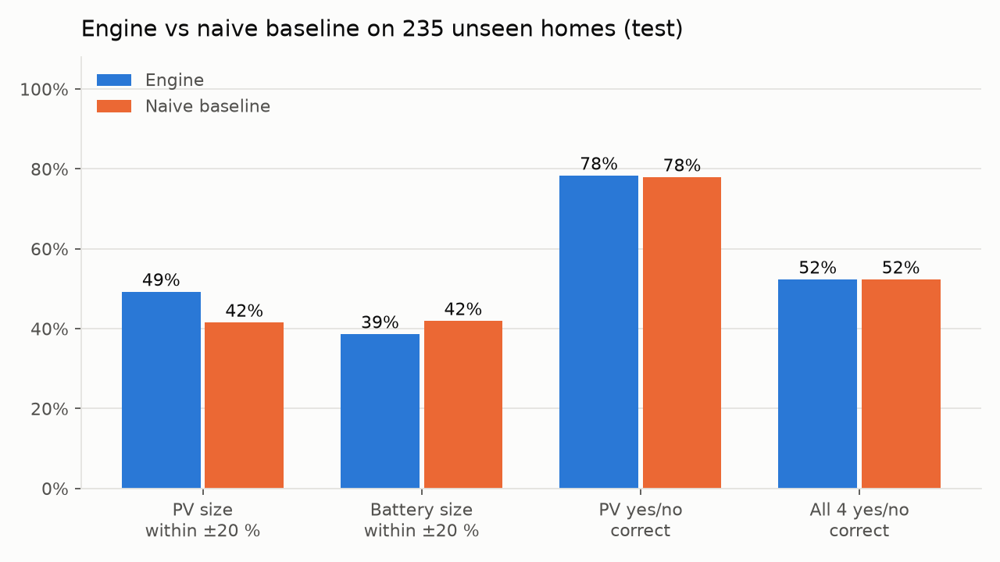
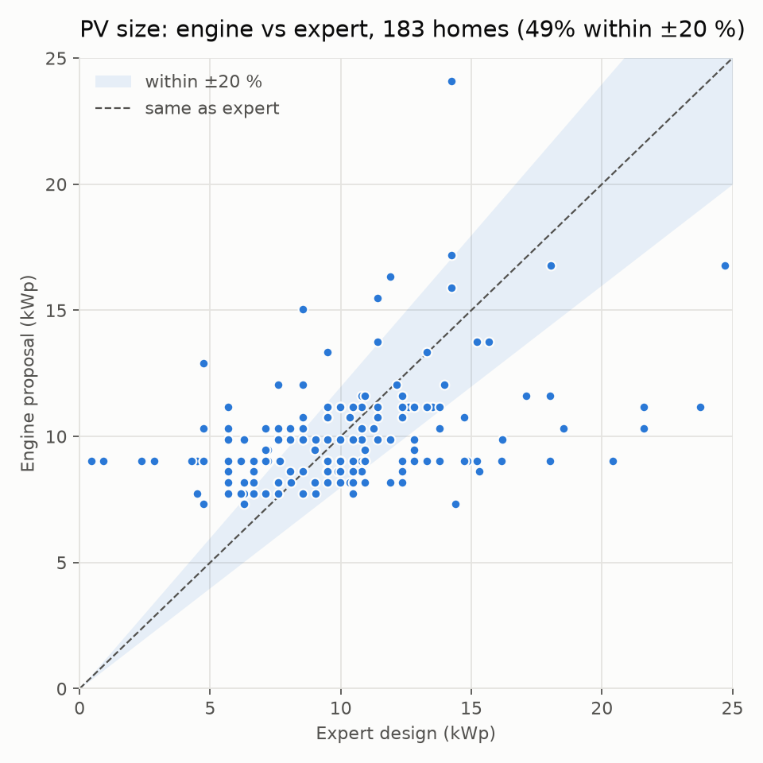
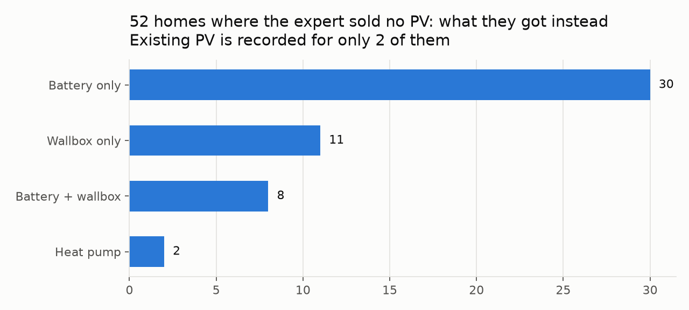

# Reality check: engine vs expert designs (test)

Model `test` on **235 homes the engine never saw** (`test` split of `data/processed/split.csv`).
Engine parameters come from `train` only. Numbers as they came out of `score.py`; nothing was tuned on this split.
Baseline: every home gets the train-median PV and battery, no heat pump, a wallbox iff it has an EV.

## Headline

| | Engine | Baseline |
|---|---|---|
| PV size within ±20 % of the expert | 49% | 42% |
| PV size, median absolute error | 1.9 kWp | |
| PV size MAE | 3.22 kWp | 3.5 kWp |
| Battery size within ±20 % | 39% | 42% |
| PV yes/no correct | 78% | 78% |
| Battery yes/no correct | 92% | 92% |
| Wallbox yes/no correct | 68% | 68% |
| All four yes/no correct | 52% | 52% |

## Where and why the engine deviates

1. **PV yes/no: the engine misses 0 PV homes, but proposes PV to 51 of the 52 homes where the expert sold none.**
   49 of those 52 homes got a battery or wallbox instead, i.e. retrofits to a home that most likely already has PV.
   The input data records existing PV for only 2 of them. This is missing input, not a sizing error:
   asking "do you already have solar?" (reo) removes it.
2. **PV size has no overall bias** (median +0.1 kWp, typical miss 1.9 kWp) and rises with demand like the expert sizes do:

| band | n | expert_kwp | engine_kwp | bias_kwp |
|---|---|---|---|---|
| <3,000 | 34 | 6.88 | 7.74 | 1.09 |
| 3,000-4,000 | 31 | 9.5 | 8.6 | 0.53 |
| 4,000-5,000 | 54 | 10.62 | 9.03 | -1.17 |
| 5,000-6,000 | 18 | 8.78 | 9.89 | 1.11 |
| 6,000+ | 46 | 11.64 | 11.18 | 0.39 |

   Per installer the residual has opposite signs, i.e. each installer has its own sizing style:

| installer | n | bias_kwp |
|---|---|---|
| 23c108b7 | 49 | -0.83 |
| 2a8ba8e2 | 134 | 0.57 |

   Part of the error is in the "truth": for `mount_count` homes the expert kWp is itself estimated from module count × typical Wp (±5 %).

| target_source | n | median_abs_err_kwp |
|---|---|---|
| module_rows | 5 | 6.65 |
| mount_count | 164 | 1.84 |
| package_name | 14 | 2.04 |

3. **Battery size: experts pick catalogue steps, the engine a ratio.** Expert sizes cluster at
   10 kWh (61), 5 kWh (50), 9 kWh (25), 7 kWh (19), 15 kWh (12);
   engine sizes at 9 kWh (98), 7 kWh (52), 10 kWh (51), 14 kWh (7), 15 kWh (5).
   The 5 vs 10 kWh choice is installer catalogue and customer budget, which the inputs do not contain.
4. **Wallbox is not predictable from the inputs.** Experts sold 73 wallboxes, only 6 to homes with `has_ev`;
   the engine proposed 13. Wallboxes are sold for planned EVs that the data does not record. reo asks about EV plans.
5. **Heat pump:** 2 expert heat pumps in this split; too few to score.

## Charts

