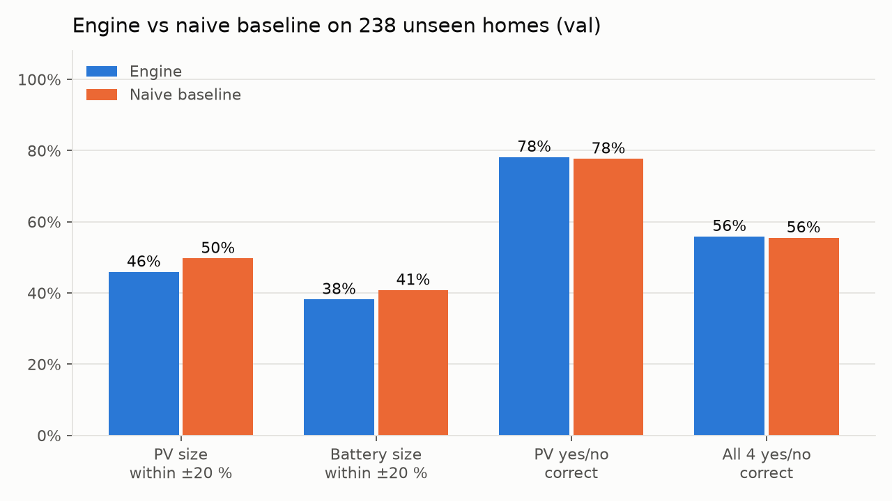
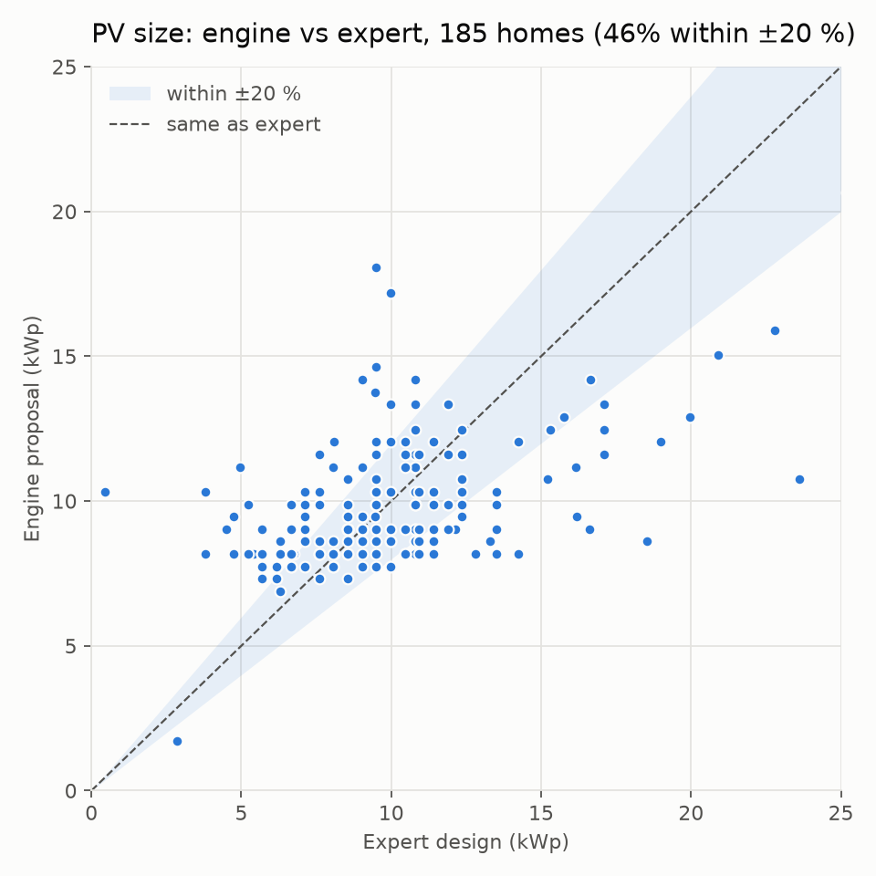
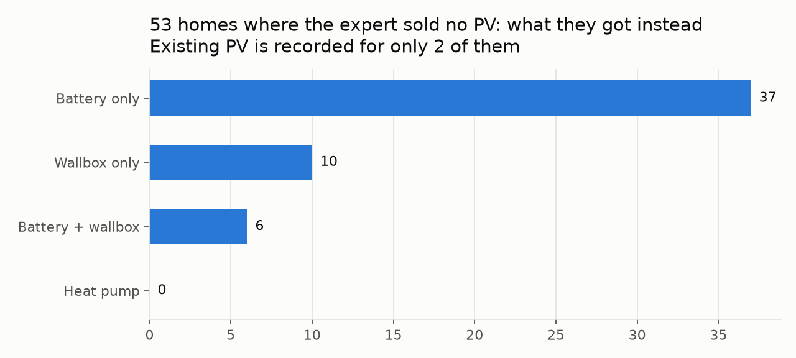

# Reality check: engine vs expert designs (val)

Model `val` on **238 homes the engine never saw** (`val` split of `data/processed/split.csv`).
Engine parameters come from `train` only. Numbers as they came out of `score.py`; nothing was tuned on this split.
Baseline: every home gets the train-median PV and battery, no heat pump, a wallbox iff it has an EV.

## Headline

| | Engine | Baseline |
|---|---|---|
| PV size within ±20 % of the expert | 46% | 50% |
| PV size, median absolute error | 2.0 kWp | |
| PV size MAE | 2.49 kWp | 2.71 kWp |
| Battery size within ±20 % | 38% | 41% |
| PV yes/no correct | 78% | 78% |
| Battery yes/no correct | 92% | 92% |
| Wallbox yes/no correct | 74% | 74% |
| All four yes/no correct | 56% | 56% |

## Where and why the engine deviates

1. **PV yes/no: the engine misses 0 PV homes, but proposes PV to 52 of the 53 homes where the expert sold none.**
   53 of those 53 homes got a battery or wallbox instead, i.e. retrofits to a home that most likely already has PV.
   The input data records existing PV for only 2 of them. This is missing input, not a sizing error:
   asking "do you already have solar?" (reo) removes it.
2. **PV size has no overall bias** (median +0.4 kWp, typical miss 2.0 kWp) and rises with demand like the expert sizes do:

| band | n | expert_kwp | engine_kwp | bias_kwp |
|---|---|---|---|---|
| <3,000 | 40 | 8.07 | 8.17 | 0.58 |
| 3,000-4,000 | 46 | 8.78 | 8.6 | 0.24 |
| 4,000-5,000 | 39 | 9.5 | 9.03 | 0.01 |
| 5,000-6,000 | 13 | 9.5 | 9.89 | 0.91 |
| 6,000+ | 47 | 10.92 | 11.61 | 0.34 |

   Per installer the residual has opposite signs, i.e. each installer has its own sizing style:

| installer | n | bias_kwp |
|---|---|---|
| 23c108b7 | 46 | -0.7 |
| 2a8ba8e2 | 139 | 0.48 |

   Part of the error is in the "truth": for `mount_count` homes the expert kWp is itself estimated from module count × typical Wp (±5 %).

| target_source | n | median_abs_err_kwp |
|---|---|---|
| module_rows | 7 | 4.53 |
| mount_count | 158 | 1.95 |
| package_name | 20 | 1.87 |

3. **Battery size: experts pick catalogue steps, the engine a ratio.** Expert sizes cluster at
   5 kWh (57), 10 kWh (55), 9 kWh (30), 7 kWh (25), 15 kWh (15);
   engine sizes at 9 kWh (86), 7 kWh (63), 10 kWh (53), 14 kWh (9), 6 kWh (2).
   The 5 vs 10 kWh choice is installer catalogue and customer budget, which the inputs do not contain.
4. **Wallbox is not predictable from the inputs.** Experts sold 62 wallboxes, only 5 to homes with `has_ev`;
   the engine proposed 9. Wallboxes are sold for planned EVs that the data does not record. reo asks about EV plans.
5. **Heat pump:** 0 expert heat pumps in this split; too few to score.

## Charts

